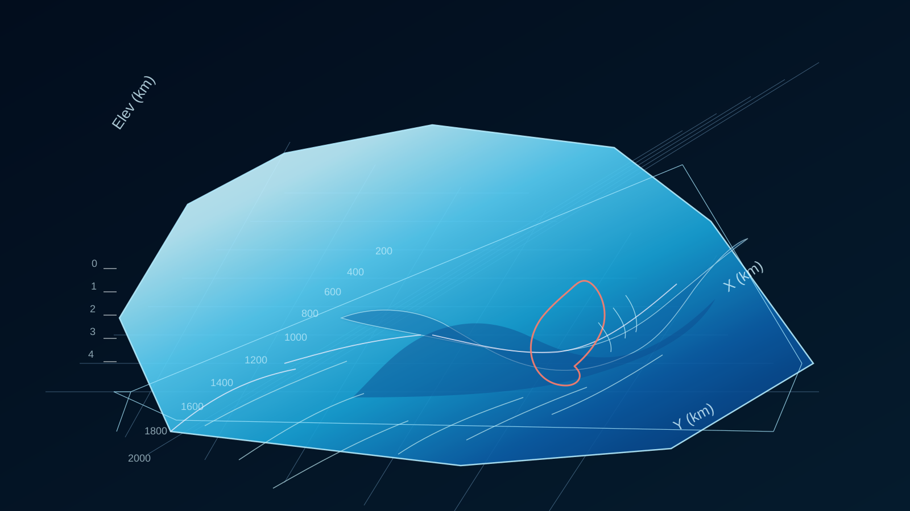

# Lambert-Amery-Ice-Sheet-Visualizations

Interactive visualizations of Lambert-Amery Ice Shelf simulations generated using ISSM and MATLAB.

## How to visualize
1. Download the HTML file.
2. Open it in any web browser (double-click the file or use "Open with Browser").
3. Enjoy!

  

